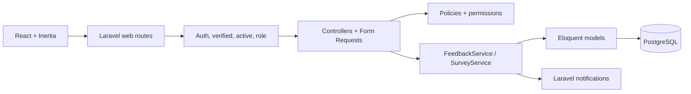

# Architecture

## Stack

- Laravel 13 provides routing, validation, Eloquent, policies, notifications, scheduler, and server-side rendering responses.
- Laravel Fortify supplies authentication actions and routes. Inertia connects Laravel controllers to React pages without a separate API service.
- React 19 and TypeScript power the interface. Base UI primitives and Tailwind CSS provide accessible controls and styling; Recharts renders report charts.
- PostgreSQL is the configured application database. Pest and PHPUnit provide the backend test runner.
- Laravel Excel and DomPDF generate XLSX and PDF reports; CSV is streamed by the report controller.

## Request flow

`resources/js/app.tsx` resolves page components under `resources/js/pages`. Shared page props and record types live in `resources/js/types`. Reusable controls live in `resources/js/components`.

## Domain services

- `FeedbackService` creates submissions, stores attachments on the configured private disk, assigns work, records status changes and replies, writes activity records, and triggers notifications.
- `SurveyService` manages survey lifecycle changes and stores answers against question snapshots so later edits do not rewrite historical answers. It rejects duplicate participation and records anonymous responses without a respondent user ID.
- `ActivityLogger` writes structured actor/action/subject entries for review in the admin audit screen.
- `routes/console.php` promotes scheduled surveys, closes expired surveys, and sends a single closing reminder for surveys ending within 24 hours. Docker runs `schedule:work` in its own service.

## Security boundaries

All authenticated application routes require verified email and an active account. Controllers use form requests, role middleware, permissions, and policies. Feedback queries are visibility-scoped, attachment downloads are authorized against the parent feedback, anonymous survey participants are represented by an HMAC participant key, and account management prevents deactivating or demoting the last active administrator.

Feedback attachments use Laravel's local storage disk by default. The app serves them through an authenticated download route rather than a public URL. Production deployments should provide private persistent storage and a real mail service.

## Key folders

| Path | Purpose |
| --- | --- |
| `app/Http/Controllers` | Inertia endpoints and application actions |
| `app/Http/Requests` | Input validation and request authorization |
| `app/Policies` | Record-level authorization |
| `app/Services` | Feedback and survey workflow rules |
| `app/Models` | Eloquent domain records |
| `database/migrations` | Schema changes |
| `database/seeders` | Roles, permissions, admin bootstrap, and categories |
| `resources/js/pages` | Inertia React pages |
| `routes` | Web routes and scheduled tasks |
| `tests/Feature` | Authentication, authorization, and workflow tests |
