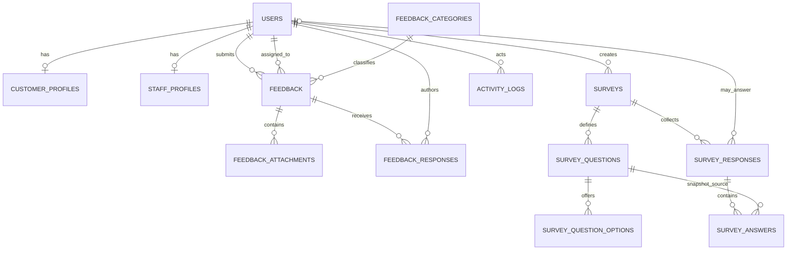

# Database model

PostgreSQL is the normal runtime database. Migrations are the schema source of truth; automated tests use an isolated in-memory SQLite database where the schema supports it.

## Main records

### Identity and access

The users table stores login identity, verification state, and the `is_active` access flag. Customer and staff profile tables hold role-specific data. Spatie Permission's role, permission, and pivot tables are created by its published migration. Roles are uppercase `ADMIN`, `STAFF`, and `CUSTOMER`.

### Feedback

Feedback rows reference their customer, category, optional staff assignee, status, and priority. Attachment records retain the private disk/path and original file name. Responses carry an `is_internal` flag; customer views exclude internal messages. Activity logs retain action metadata and subject identifiers.

### Surveys

Surveys have lifecycle status, visibility mode, scheduling bounds, and an optional one-time reminder timestamp. Questions have a type, required flag, ordering, and optional answer options. A response has a nullable respondent and participant key. Each answer stores structured answer data plus question title/type/options snapshots for stable historical reporting.

## Migrations and seed data

- `0001_01_01_000000_create_users_table.php`: users and password reset support.
- `2026_11_18_000001_create_customer_feedback_tables.php`: customer feedback, surveys, and activity tables.
- `2026_11_18_000002_create_notifications_table.php`: database notifications.
- `2026_11_18_152325_create_permission_tables.php`: Spatie permission schema.
- Remaining timestamped migrations are the Laravel cache and queue tables.

`DatabaseSeeder` installs roles and permissions, default feedback categories, and an optional initial admin. The admin requires `INITIAL_ADMIN_EMAIL` and `INITIAL_ADMIN_PASSWORD`; no default password is embedded in source.

## Data handling notes

- Survey answer history is preserved in answer snapshots even if a survey author edits question text or choices later.
- Anonymous survey response records keep `respondent_id` null; the participant key supports duplicate checks without storing a user foreign key on that response.
- Uploaded feedback files are stored using the configured filesystem disk. Do not expose the private storage path through a web server.
- Reports aggregate at query time; there is no separate analytics warehouse or precomputed report store.
